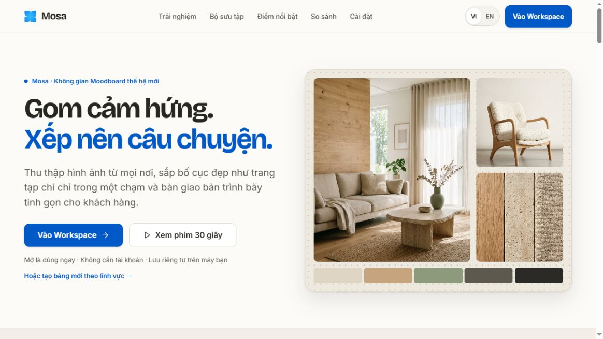
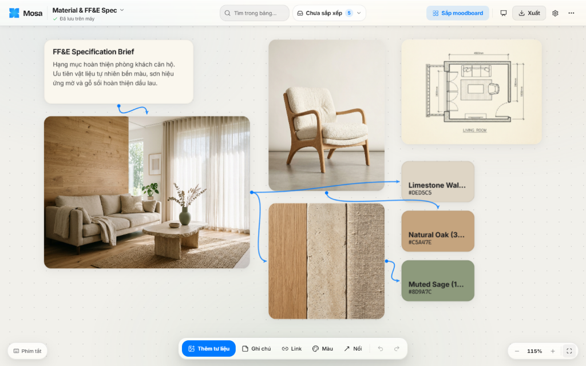
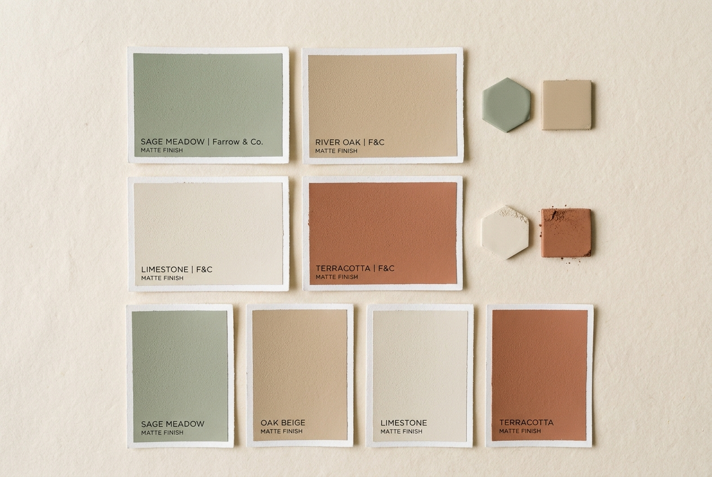

# Mosa — Local-First AI Moodboard Workspace

**Gom cảm hứng · "Shape" tầm nhìn**

**Mosa** là không gian làm moodboard **local-first** chạy trực tiếp trên trình duyệt dành cho nhà thiết kế nội thất, đồ họa, kiến trúc sư và người làm sáng tạo. Toàn bộ dự án, hình ảnh và tệp đính kèm được lưu riêng tư ngay trên máy người dùng bằng **IndexedDB** (có thể xuất gọn thành 1 tệp `.mosa`), kết hợp mô hình AI phân loại thị giác **CLIP (`Xenova/clip-vit-base-patch32`, `dtype: 'q8'`)** chạy 100% cục bộ qua **Web Worker + WASM**.

- **Trải nghiệm trực tiếp (Live MVP):** [https://anomal-gre.github.io/moodboard-web/](https://anomal-gre.github.io/moodboard-web/)
- **Điểm vào nhanh:**
  - `/` — **Mosa — Landing Page** *(phim mô phỏng 30 giây, bộ sưu tập 3 phong cách, so sánh & cài đặt PWA)*
  - `/#app` — **Mosa — Workspace** *(vào thẳng bảng vẽ mà không cần đăng nhập)*

---

## Giao diện Mosa

| Trang giới thiệu (`Mosa — Landing Page`) | Không gian làm việc (`Mosa — Workspace`) |
| :---: | :---: |
|  |  |

Bộ ảnh mẫu đi kèm trong `public/samples/` giúp bạn mở bảng và thử ngay mọi tính năng mà không cần chuẩn bị ảnh trước.

| Không gian | Chất liệu | Bảng màu |
| :---: | :---: | :---: |
|  |  |  |

---

## 1. Yêu cầu môi trường & Chạy local

- **Node.js:** `>= 20` (đã kiểm thử trên Node `v24.21.0`)
- **Trình duyệt khuyến nghị:** Chromium desktop (Chrome, Microsoft Edge, Vivaldi, Brave) phiên bản mới.

```bash
npm ci
npm run dev              # Chạy môi trường phát triển tại http://127.0.0.1:4313
npm test                 # Chạy bộ 17 bài kiểm thử tự động (storage, backup, touchpad, clipper)
npm run build            # Đóng gói mosa-clipper.zip, kiểm tra TypeScript (tsc -b) và build dist/
npm run preview          # Xem thử bản build production tại http://127.0.0.1:4313
npm run package:clipper  # Đóng gói lại public/downloads/mosa-clipper.zip từ mosa-clipper/
```

> Lưu ý trên Windows PowerShell nếu ExecutionPolicy chặn `npm.ps1`, dùng `npm.cmd ci`, `npm.cmd run dev`, `npm.cmd test`, `npm.cmd run build`, `npm.cmd run preview`.

---

## 2. Tính năng nổi bật

### Landing Page, Onboarding & Hybrid PWA
- **Landing Page đồng bộ nhận diện:** Tông giấy ấm studio, phím chuyển song ngữ **VI / EN**, phim mô phỏng 30 giây theo 4 chương (`Thu thập → Nhận diện → Sắp bố cục → Bàn giao`), bộ sưu tập 3 phong cách chuyển tab trực tiếp và cuộn quán tính mượt không phụ thuộc thư viện ngoài (`useSmoothScroll.ts`).
- **Onboarding 2 bước theo lĩnh vực:** Chọn *Nội thất & Kiến trúc*, *Vật liệu & Bảng FF&E*, *Đồ họa & Thương hiệu* hoặc *Bảng trống* để khởi tạo sẵn bảng mẫu phù hợp.
- **Hybrid PWA (`public/sw.js`, `manifest.webmanifest`):** Dùng tức thì trên trình duyệt hoặc cài thành cửa sổ App Desktop độc lập — dùng chung một kho dữ liệu IndexedDB duy nhất và hoạt động cả khi mất mạng.

### Artboard tương tác & Điều hướng tự nhiên
- **Điều hướng tự động cho cả Touchpad lẫn Chuột rời (`src/board/wheelNavigation.ts`):** Tự nhận diện trượt 2 ngón di chuyển 2D (kèm khóa quán tính), chụm 2 ngón phóng to/thu nhỏ trên Touchpad và cuộn con lăn neo theo con trỏ trên chuột rời — không cần chuyển chế độ thủ công.
- **Thao tác canvas đầy đủ:** Zoom 10%–300%, Fit board / Fit vùng chọn, chọn đơn / `Shift + Click` / Lasso, kéo thả mượt theo `requestAnimationFrame`, Resize giữ tỉ lệ, Cắt ảnh (Crop), Khóa vị trí, Nhóm/Tách nhóm (Frame), Sắp lớp, Cân hàng & giãn đều, Nhân bản (`Ctrl+D`), Sao chép/Dán nội bộ (`Ctrl+C/V`), Hoàn tác/Làm lại 40 bước (`Ctrl+Z / Ctrl+Shift+Z`).
- **6 loại thẻ + Mũi tên nối:** **Ảnh, Ghi chú (sửa trực tiếp), Link, Màu HEX (sao chép 1 chạm + trích bảng màu), Tệp thiết kế (`DWG/PSD/AI/INDD`), Khung nhóm (Frame)**, kèm công cụ **Nối mũi tên** giữa các thẻ và chế độ **Soi sắc độ (Trắng-Đen / Grayscale)** trong Cài đặt.
- **Nền bảng & Song ngữ:** Chuyển nhanh giữa **Giấy sáng**, **Tối Studio** hoặc mã màu HEX tùy chọn, bật/tắt lưới chấm, và đổi giao diện **Tiếng Việt / English**.

### AI chạy cục bộ 100% trên trình duyệt
- **Nhận diện 6 yếu tố thiết kế phổ quát (`src/workers/classify.worker.ts`):** Sử dụng `Xenova/clip-vit-base-patch32` (`dtype: 'q8'`, WASM) để phân loại ảnh theo 6 yếu tố áp dụng cho mọi ngành sáng tạo: *Không gian & Bối cảnh, Hình khối & Vật thể, Kết cấu & Bề mặt, Màu sắc, Đường nét & Cấu trúc, Chữ & Typography* (tương thích ngược hoàn toàn với tệp `.mosa` cũ).
- **Quy trình Human-in-the-loop:** Chỉ tải mô hình 1 lần đầu (~80 MB, tự lưu Browser Cache cho các lần sau chạy 100% offline), hỗ trợ dừng giữa chừng, xem độ khớp, chỉnh tay nhãn trước khi áp dụng và tự giải phóng Worker sau khi xong.
- **Tách nền ngoại tuyến (`src/workers/cutout.worker.ts`):** Xử lý tách nền nhanh ngay trên máy cho các ảnh vật thể/nội thất nền đơn giản mà không cần gửi ảnh lên server.

### Sắp moodboard tự động (0° Editorial)
- **4 kiểu bố cục:** **Editorial Bento**, **Tự do (Collage)**, **Phân khu (Zones)** và **Lưới đều (Grid)** — giữ thẳng 0°, ưu tiên đúng ảnh chủ đạo, bảo vệ các cụm thẻ đã nối mũi tên, tôn trọng thẻ đang khóa/vùng chọn và **xem trước trực tiếp** trước khi Áp dụng.
- **Trích bảng màu tự động:** Tự rút dải màu hài hòa (60-30-10) từ các ảnh trên bảng để tạo thẻ màu HEX nhanh.

### Bàn giao chuẩn Studio & Lưu trữ Local-First
- **Dự toán FF&E tự cộng tổng:** Nhập mã hàng, số lượng, đơn giá ngay trên Inspector để tự tính tổng ngân sách.
- **Đa dạng định dạng xuất:**
  - **PDF mang logo riêng (White-label Studio Deck)** kèm bảng thông số FF&E.
  - **Tệp `.html` tương tác cho khách duyệt (Client Review):** Tệp đơn độc lập để khách xem, ghi chú và bấm duyệt trực tiếp không cần tài khoản.
  - **Ảnh PNG (1× / 2×)** hỗ trợ toàn bảng hoặc vùng chọn kèm tùy chọn xuất danh sách nguồn **`-sources.json`**.
- **Chế độ Trình bày (Present Mode):** Ẩn toàn bộ thanh công cụ, pan/zoom tự do và nhấn `Esc` quay lại góc nhìn cũ.
- **Sở hữu trọn dữ liệu cục bộ:** Lưu trên **IndexedDB** (`moodboard-workspace`, deduplication bằng SHA-256), theo dõi dung lượng trực tiếp, bảo vệ xung đột khi mở nhiều tab, xuất/nhập gói dự án **`.mosa`** (giới hạn 100 MB) và **Đồng bộ thư mục cục bộ** để sao lưu tự động sang Google Drive, OneDrive hoặc iCloud.

---

## 3. Tiện ích trình duyệt Mosa Web Clipper (`mosa-clipper/`)

Repo tích hợp sẵn tiện ích **Chrome / Edge / Vivaldi (Manifest V3)** tại [`mosa-clipper/`](mosa-clipper/) và tự động đóng gói sẵn tệp tải nhanh tại `public/downloads/mosa-clipper.zip` (tải trực tiếp ngay trên Landing Page hoặc khay **Chưa sắp xếp**).

- **Cài đặt 3 bước:** Mở `chrome://extensions` (hoặc `edge://extensions` / `vivaldi://extensions`) → Bật **Developer mode** → Chọn **Load unpacked** → Trỏ tới thư mục `mosa-clipper/`.
- **Lưu ảnh 1 chạm không lỗi CORS:** Chuột phải lên ảnh, bấm nút nổi **Mosa** hoặc giữ `Alt + Click` để hút ảnh gốc sắc nét nhất (tự nâng cấp `/originals/` trên Pinterest) vào khay **Chưa sắp xếp** kèm đúng đường dẫn trang gốc.
- **Kết nối linh hoạt:** Tự nhận bản GitHub Pages (`anomal-gre.github.io/moodboard-web`) và tab local (`http://127.0.0.1:4313`). Khi chạy Mosa ở trình duyệt khác trên máy cục bộ, lấy mã ghép nối trong **Chưa sắp xếp → Mosa Web Clipper → Lấy mã kết nối trình duyệt khác** (có thể cố định mã bằng biến môi trường `MOSA_CLIPPER_TOKEN` dài 32–128 ký tự).
- **Hàng chờ bền vững:** Giữ ảnh chờ đúng dự án đích ngay cả khi khởi động lại trình duyệt và chỉ báo thành công sau khi Mosa xác nhận đã ghi vào IndexedDB.

---

## 4. Lưu ý về Lưu trữ, AI cục bộ & Giới hạn trình duyệt

1. **Dữ liệu gắn với trình duyệt hiện tại:** Dự án và ảnh nằm trong IndexedDB cục bộ. Nên dùng tệp `.mosa` hoặc tính năng liên kết thư mục đồng bộ để sao lưu và chuyển máy.
2. **Lần chạy AI đầu tiên:** Cần mạng lần đầu để tải mô hình CLIP (~80 MB) và runtime WASM vào Browser Cache; các lần sau chạy hoàn toàn ngoại tuyến.
3. **CORS trên một số trang web:** Nếu dán URL trực tiếp bị website nguồn chặn CORS, Mosa vẫn giữ thẻ cùng link gốc ở trạng thái `remote-only` (hỗ trợ **Thay ảnh** không mất nguồn); khuyến nghị dùng **Mosa Web Clipper** để lưu ảnh gốc mượt nhất.

---

## 5. Kiểm thử tự động (`npm test`)

Bộ **17 bài kiểm thử** bằng `node:test` nằm trong thư mục `tests/`:

- `tests/workspace.test.mjs` — Xung đột ghi nhiều tab, tuần tự hóa ghi cùng tab, round-trip sao lưu `.mosa` v1 & định dạng cũ, giao dịch nhận clip.
- `tests/wheelNavigation.test.mjs` — Nhận diện trượt 2 ngón Touchpad + khóa quán tính, chụm 2 ngón pinch-to-zoom, con lăn chuột bước rời và chế độ tường minh.
- `tests/clipper.test.mjs` — Hàng chờ bền vững qua restart, giới hạn hàng chờ, nhận diện tên miền chính thức và đối chiếu khớp mã nguồn với `mosa-clipper.zip`.
- `tests/local-bridge.test.mjs` — Xác thực local relay token và endpoint mở tệp thiết kế cục bộ.

---

## 6. Cấu trúc mã nguồn

```text
moodboard-web/
  docs/images/          # Ảnh chụp Landing Page & Workspace cho tài liệu
  mosa-clipper/         # Chrome / Edge / Vivaldi MV3 Web Clipper Extension
  public/
    brand/logo.svg      # Biểu tượng vector Mosa
    downloads/          # mosa-clipper.zip (tự động build & deploy kèm web)
    fonts/              # Bricolage Grotesque & Inter offline (.woff2)
    samples/            # 5 ảnh mẫu lưu cục bộ cùng bản build
    manifest.webmanifest & sw.js  # Cấu hình Hybrid PWA & cache offline
  scripts/
    package-clipper.mjs # Script đóng gói ZIP tự động cho Mosa Web Clipper
  src/
    board/              # BoardViewport, CardView, SelectionOverlay, useBoardInteractions, wheelNavigation
    components/         # AppleSelect và các thành phần giao diện dùng chung
    domain/             # types, project, templates, history, geometry, arrange, validate, paletteExtract
    features/           # landing (LandingPage, InteractiveDemoStage, OnboardingModal, useSmoothScroll, usePwaInstall),
                        # projects, inspector, inbox, clipper, appearance, capture, classification, export
    storage/            # indexedDb, workspaceRepository, localFolderSync, storageHealth, assets, backup
    workers/            # classify.worker.ts (CLIP WASM), cutout.worker.ts
    i18n/               # vi.ts, en.ts (song ngữ Việt - Anh đầy đủ)
    styles/             # tokens.css, app.css
  tests/                # 17 unit & integration tests (node --test)
```

---

## Tác giả

Phát triển bởi **Trần Gia Bảo (Anomal)** — Graphic Designer & Product Builder · [anomal.ohwow.win](https://anomal.ohwow.win) · Dự án dự thi **Say AI Ambassador 2026 | Workshop #03**.
