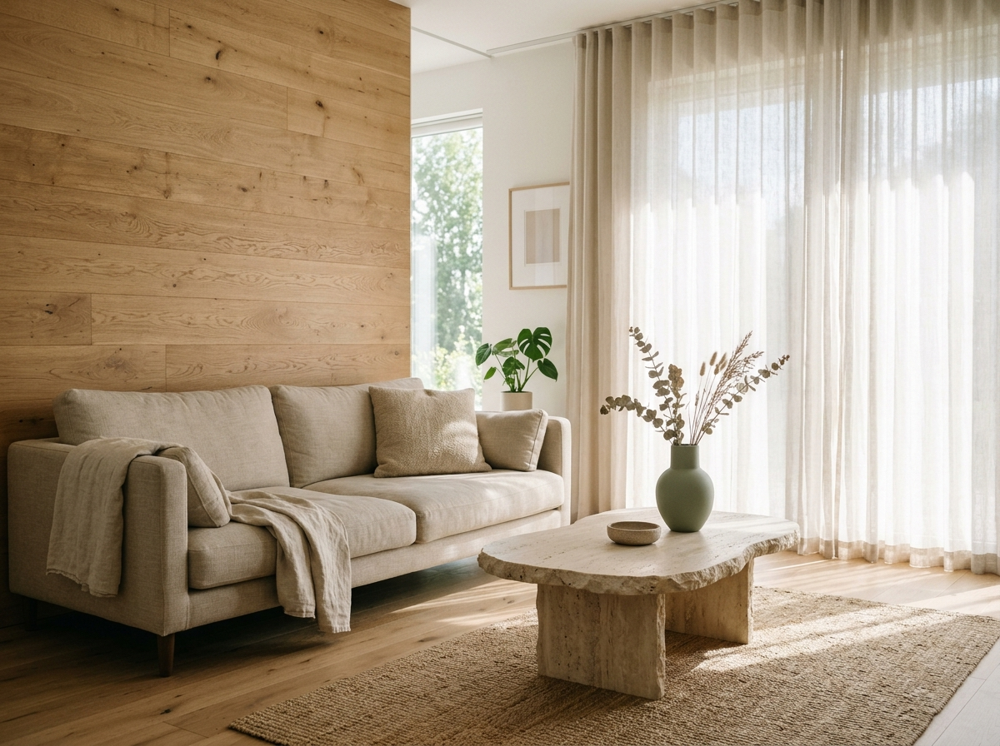
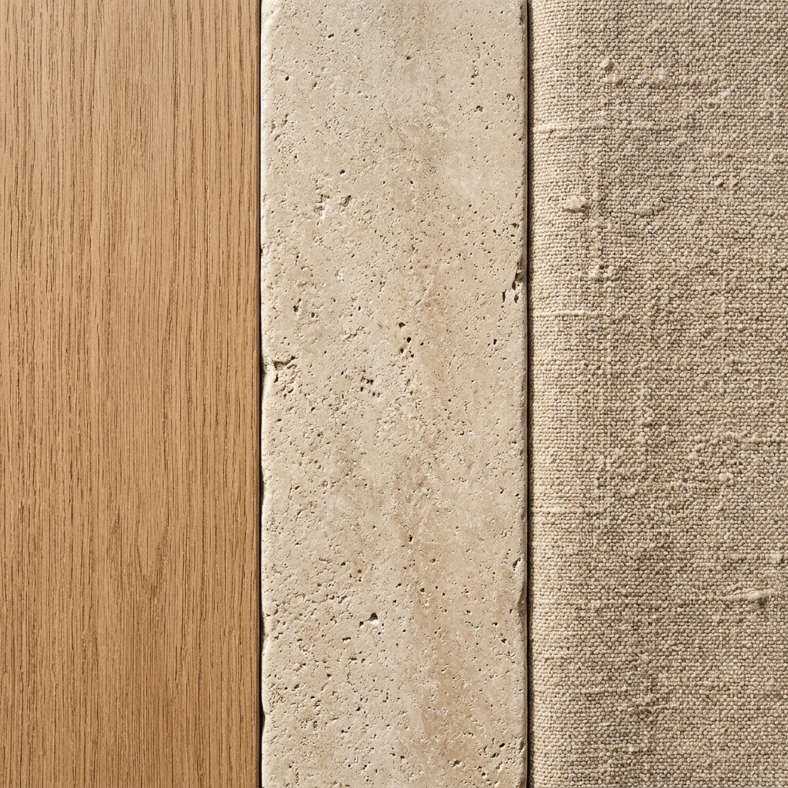

# Mosa - Web Moodboard Local-First cho Designer Nội thất

Ứng dụng web moodboard local-first xây dựng bằng **React, TypeScript, Vite**, lưu trữ hoàn toàn trên máy người dùng bằng **IndexedDB** và chạy mô hình AI phân loại ảnh **CLIP (`Xenova/clip-vit-base-patch32`, `dtype: 'q8'`)** trực tiếp trong trình duyệt qua **Web Worker + WASM**.

Triết lý cốt lõi: **Gom trước, xếp sau, truy lại nguồn, chỉnh tay được.**

## Giao diện Mosa


Bộ ảnh mẫu đi kèm giúp bạn bắt đầu tạo moodboard ngay trong ứng dụng.

| Không gian | Chất liệu | Bảng màu |
| --- | --- | --- |
|  |  |  |


---

## 1. Yêu cầu môi trường & Chạy local

* **Node.js:** `>= 20` (đã kiểm thử trên Node `v24.21.0`, npm `11.19.0`)
* **Trình duyệt khuyến nghị:** Chromium desktop (Chrome, Edge, Vivaldi, Brave) phiên bản mới.

```bash
npm ci
npm run dev       # Chạy môi trường phát triển tại http://127.0.0.1:4313
npm test          # Kiểm thử lưu, sao lưu, gửi lại clip và bridge cục bộ
npm run build     # Kiểm tra TypeScript (tsc -b) và build bản production vào dist/
npm run preview   # Xem thử bản build production tại http://127.0.0.1:4313
```

> Lưu ý trên Windows PowerShell nếu ExecutionPolicy chặn `npm.ps1`, dùng `npm.cmd ci`, `npm.cmd run dev`, `npm.cmd run build`, `npm.cmd run preview`.

---

## 2. Tính năng đã triển khai (M1 - M7)

* **Artboard tương tác (M1-M2):**
  * Mở ngay board mẫu **Không gian sống · 01** (với 5 ảnh nội thất mẫu lưu cục bộ trong `public/samples/`), hỗ trợ nền giấy sáng (`#F1F0EB`), xưởng tối (`#191D1A`) hoặc màu HEX tùy chọn, lưới chấm, chuyển đổi **Tiếng Việt / English**.
  * Pan (Space + kéo / chuột giữa / cuộn chuột), Zoom 10%-300% neo tại con trỏ (`Ctrl/Cmd + cuộn`), Fit board, chọn đơn / `Shift + Click` / Lasso, kéo thả mượt theo `requestAnimationFrame`, Resize ảnh giữ tỉ lệ, Khóa vị trí, Nhóm/Tách nhóm (Frame), Sắp lớp, Cân trái/trên & Giãn ngang, Nhân bản (`Ctrl+D`), Sao chép/Dán nội bộ (`Ctrl+C/V`), Hoàn tác/Làm lại 40 bước (`Ctrl+Z / Ctrl+Shift+Z`).
  * Hỗ trợ 6 loại card: **Ảnh, Ghi chú (nhấp đúp sửa trực tiếp), Link, Màu HEX (sao chép 1 chạm + trích bảng màu từ ảnh), File thiết kế (`DWG/PSD/AI/INDD` metadata), Khung nhóm (Frame)**.
* **Thu thập, giữ nguồn & lưu cục bộ (M3):**
  * Kéo thả ảnh từ thư mục, dán ảnh/URL/chữ từ clipboard, hộp thoại thêm Link, khay **Chưa sắp xếp (Inbox)** hỗ trợ kéo ra đúng vị trí trên bảng, **Thùng rác** khôi phục card, **Tìm kiếm** nhảy thẳng tới card hoặc mở khay.
  * Tách bạch `pageUrl` (URL trang nguồn) và `imageUrl` (URL ảnh CDN); hỗ trợ thay ảnh (`remote-only` / `missing`) mà không làm mất tọa độ, nhãn và URL nguồn đã nhập.
  * Lưu trữ theo kiến trúc **IndexedDB** (`moodboard-workspace`) tách riêng `meta`, `projects`, `assetMeta` và `assetBytes` (kèm deduplication bằng SHA-256 và thumbnail tối đa 1.120 px).
* **Sắp moodboard tự động (M4):**
  * Chế độ **Tự do (Collage)** và **Lưới đều (Grid)**, tùy chọn **Gom theo phân loại**, thanh trượt **Độ xếp chồng (0-100%)**, tôn trọng vùng chọn, bảo vệ card/nhóm đang khóa, **Xem trước trực tiếp trên bảng** trước khi Áp dụng hoặc Hủy.
* **AI phân loại ảnh chạy cục bộ trên máy (M5):**
  * Dùng `@huggingface/transformers` trong `src/workers/classify.worker.ts` với `Xenova/clip-vit-base-patch32` (`dtype: 'q8'`, WASM).
  * Chỉ tải model khi người dùng nhấn **Phân loại AI** lần đầu (~90-150 MB, tự lưu cache trình duyệt cho các lần sau).
  * Quy trình **Human-in-the-loop**: hiển thị tiến độ tải & phân tích từng ảnh (thu nhỏ ≤ 512 px), hỗ trợ **Dừng**, báo lỗi lẻ theo ảnh, cho xem điểm khớp tương đối, sửa nhãn qua dropdown rồi mới bấm **Áp dụng** (1 bước Undo) và tự giải phóng Worker sau khi xong.
* **Trình bày, Xuất PNG & Sao lưu dự án (M6):**
  * Chế độ **Trình bày** ẩn toàn bộ thanh công cụ, cho pan/zoom tự do và `Esc` để quay lại góc nhìn cũ.
  * Xuất **PNG** (1× hoặc 2×) bằng Canvas 2D cho toàn bảng hoặc vùng chọn, xử lý tọa độ âm, kiểm tra giới hạn an toàn trình duyệt (≤ 12.000 px mỗi cạnh và ≤ 36 triệu pixel), cảnh báo ảnh thiếu (cho chọn quay lại sửa hoặc xuất ô giữ chỗ), kèm tùy chọn xuất danh sách nguồn **`-sources.json`**.
  * Mở **Xuất** cạnh **Trình bày** và dùng **Vừa vùng chọn** cạnh **Vừa bảng** để đọc một cụm thẻ.
  * Xuất / nhập bản sao **`.mosa`** hoặc **`.moodboard.json`** gồm thông tin dự án, liên kết giữa thẻ, ảnh và tệp thiết kế đính kèm. Giới hạn xuất và nhập là 100 MB. Mosa mở bản sao dưới dạng dự án riêng và ghi toàn bộ dữ liệu trong một giao dịch.

---

## 3. Lưu ý về Lưu trữ, AI cục bộ và Giới hạn trình duyệt

1. **Dữ liệu theo origin trình duyệt.** Dự án và ảnh nằm trong IndexedDB của trình duyệt hiện tại. Dùng bản sao để chuyển máy hoặc lưu dự phòng. Khi hai tab cùng sửa một dự án, tab có bản cũ sẽ báo xung đột. Chọn **Giữ bản nháp và nạp bản mới** để lưu các sửa đổi trong dự án riêng rồi mở bản đã lưu.
2. **Tải mô hình AI lần đầu:** Lần đầu bấm *Phân loại AI*, trình duyệt cần kết nối mạng để tải tệp mô hình CLIP và runtime WASM từ Hugging Face CDN vào Browser Cache. Sau khi đã cache, các lần phân loại tiếp theo chạy nhanh hơn rõ rệt và hoàn toàn trên máy.
3. **Giới hạn nguồn web & CORS:** Một số website chặn tải trực tiếp bytes ảnh do CORS hoặc yêu cầu đăng nhập; ứng dụng vẫn giữ card cùng URL gốc ở trạng thái `remote-only` và cung cấp nút **Thay ảnh** mà không làm mất URL nguồn.
4. **Mở tệp thiết kế.** Tauri và Mosa chạy cục bộ mở các định dạng thiết kế được hỗ trợ từ bản đính kèm đã lưu. Các định dạng khác dùng chế độ xem trong trình duyệt hoặc tải xuống tùy loại tệp. Gắn lại tệp nếu thẻ cũ chỉ lưu đường dẫn.

---

## 4. Tiện ích trình duyệt Mosa Web Clipper (`mosa-clipper/`)

Repo đã tích hợp sẵn tiện ích Chrome / Edge / Vivaldi (Manifest V3) tại thư mục `mosa-clipper/` và gói tải nhanh `public/downloads/mosa-clipper.zip` (có nút tải trực tiếp trong khay **Chưa sắp xếp (Inbox)** trên bản web).

* **Cách cài đặt:** Mở `chrome://extensions` (hoặc `edge://extensions` / `vivaldi://extensions`) → Bật **Developer mode** → Chọn **Load unpacked** → Chọn thư mục `mosa-clipper/`.
* Clipper tự nhận bản GitHub Pages của dự án và tab local `http://127.0.0.1:4313`. Với Vercel hoặc tên miền riêng, nhập URL đầy đủ của Mosa trong mục kết nối của tiện ích.
* Nếu Mosa cục bộ mở ở trình duyệt khác, vào **Chưa sắp xếp → Mosa Web Clipper → Lấy mã kết nối trình duyệt khác** rồi dán mã vào phần kết nối của tiện ích. Mã mặc định đổi mỗi lần khởi động máy chủ. Có thể đặt `MOSA_CLIPPER_TOKEN` bằng một mã ngẫu nhiên dài 32–128 ký tự, dùng chữ, số, `_` hoặc `-`, để dùng lại mã giữa các lần chạy.
* Ảnh đang chờ được lưu ở tiện ích và giữ nguyên dự án đích sau khi đã xác định. Clipper báo đã lưu khi Mosa xác nhận ghi vào IndexedDB. Khi hàng chờ đầy, tiện ích báo lỗi và giữ các ảnh đã xếp hàng.
* Sau khi cập nhật, reload tiện ích tại thư mục cài đặt hiện tại và tải lại tab Mosa cùng các tab nguồn. `npm run package:clipper` tạo ZIP từ mã nguồn tiện ích. Lệnh build cũng cập nhật gói ZIP.

---

## 5. Cấu trúc mã nguồn

```text
moodboard-web/
  mosa-clipper/         # Chrome / Edge / Vivaldi MV3 Web Clipper Extension
  public/
    brand/logo.svg
    downloads/          # mosa-clipper.zip (tự động deploy kèm GitHub Pages)
    fonts/              # Bricolage Grotesque & Inter offline (.woff2)
    samples/            # 5 ảnh mẫu nội thất lưu cùng bản build
  src/
    domain/             # types, project, templates, history, geometry, arrange, validate, paletteExtract
    board/              # BoardViewport, CardView, SelectionOverlay, useBoardInteractions
    features/           # projects, inspector, inbox, clipper, appearance, capture, classification, export
    storage/            # indexedDb, workspaceRepository, localFolderSync, storageHealth, assets, backup
    workers/            # classify.worker.ts (CLIP WASM), cutout.worker.ts
    i18n/               # vi.ts, en.ts
    styles/             # tokens.css, app.css
```
